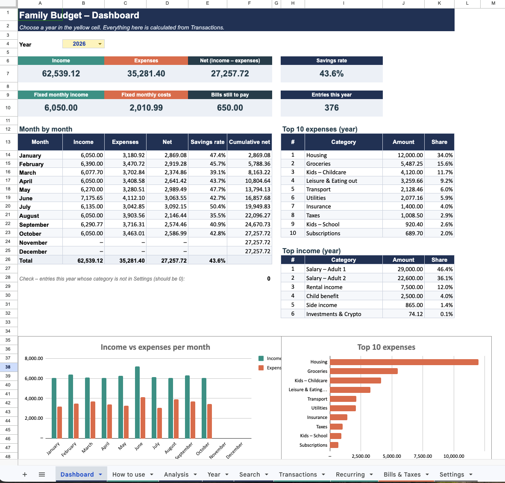
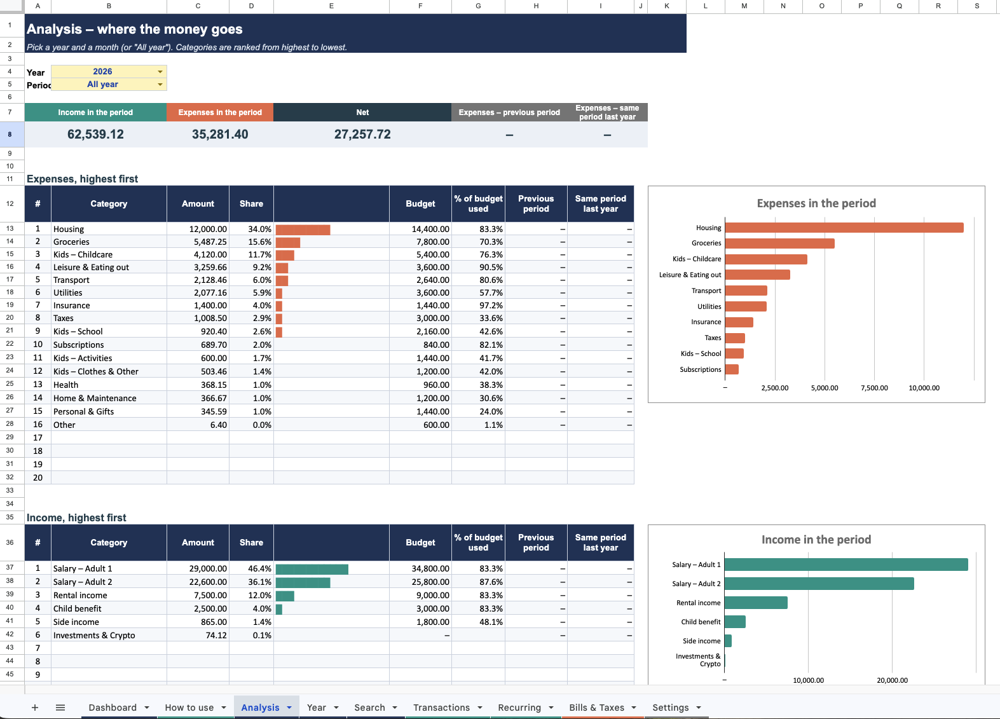
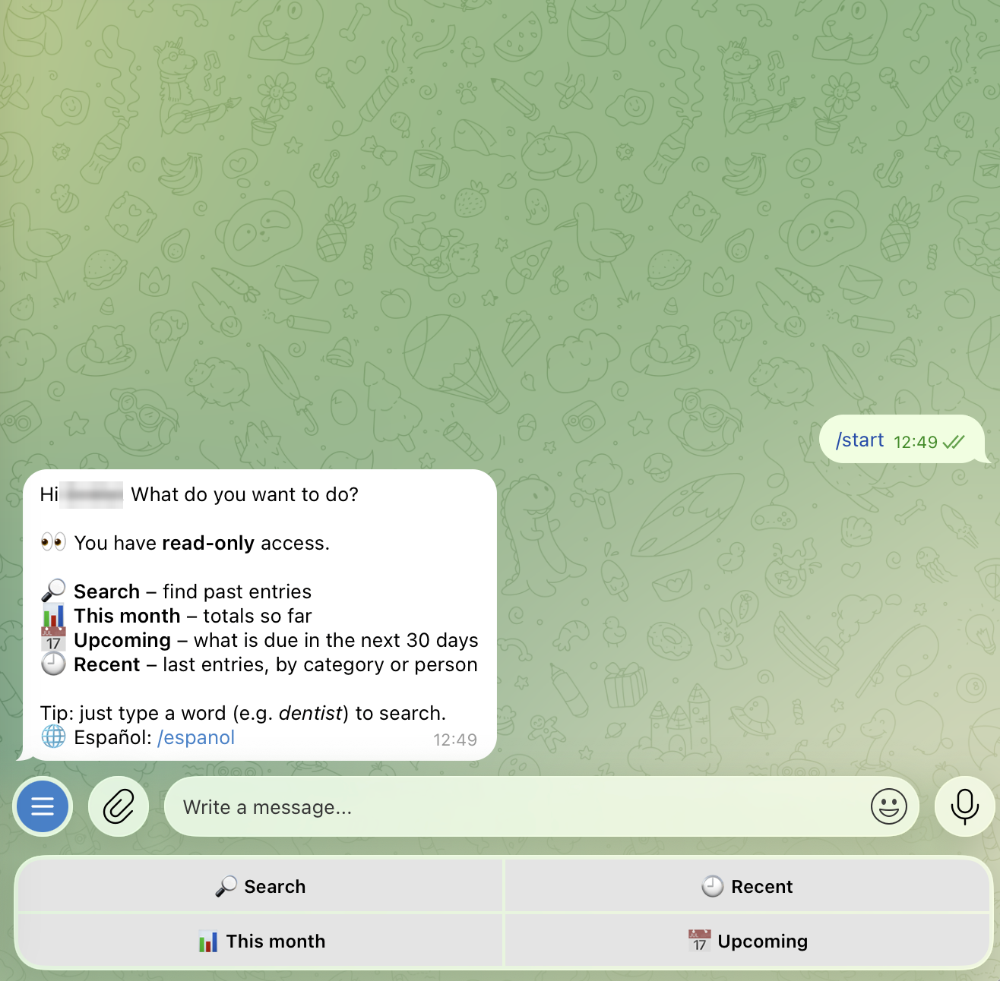

# Presupuesto familiar – Hoja de Google + bot de Telegram

Un presupuesto familiar gratuito que vive en **tu propia hoja de Google**, con un **bot de Telegram** opcional para apuntar gastos desde el móvil en pocos toques. Sin servidor, sin suscripción y sin ninguna IA leyendo tus datos: solo una hoja de cálculo y un menú de botones.

*In English? Read [README.md](README.md).*

## Capturas

*Todas las capturas usan los archivos de demostración, con datos inventados. Se muestran en inglés; la plantilla en español es igual.*

**Panel** – el año de un vistazo

**Análisis** – cada categoría ordenada, frente a su presupuesto

**Telegram** – el menú de un usuario de solo lectura

## Qué incluye

**La hoja de cálculo** (en español o en inglés)

- **Panel** – elige un año: ingresos, gastos, tasa de ahorro, tabla mes a mes, top 10 gastos y gráficos.
- **Análisis** – elige un año y un mes (o el año entero): cada categoría de mayor a menor, con su peso, presupuesto usado, periodo anterior y mismo periodo del año anterior.
- **Año** – cada categoría mes a mes frente a su presupuesto, y el gasto por persona y por quién pagó.
- **Buscar** – filtra por palabra, tipo, categoría, año, mes o persona.
- **Recurrentes** – alquiler, sueldos, cuotas… se añaden solos en su fecha.
- **Facturas e impuestos** – pagos puntuales o anuales con aviso antes del vencimiento.
- **Configuración** – tus categorías, personas, pagadores y formas de pago. Para añadir un hijo/a, un adulto o una categoría, escríbelo en una fila vacía.

**El bot de Telegram** (opcional)

- Botones, no comandos: ➖ Gasto, 🧾 Impuesto, ➕ Ingreso, 🔎 Buscar, 📊 Este mes, 📅 Próximos, 🕘 Últimos, ↩️ Deshacer.
- Al añadir un gasto muestra los últimos movimientos de esa categoría, para no apuntar lo mismo dos veces.
- 🕘 Últimos muestra para quién era cada movimiento y quién lo apuntó, con filtro por categoría o persona.
- Varias monedas: escribe `42000 ars` o `100 usd` y lo convierte con el tipo de cambio de ese mes.
- Avisos de facturas y registro automático de los recurrentes.
- 📤 Exportar opcional: un mes o un año como archivo CSV en el chat. Desactivado por defecto; quien gestiona la hoja lo activa, y solo lo tienen los usuarios con acceso total.
- **Cerrado por defecto:** solo responde a los IDs de Telegram de la hoja. Usuarios con acceso total y de solo lectura. Las personas nuevas entran con una palabra secreta y un toque tuyo.
- Español e inglés, a elección de cada persona (`/english`, `/espanol`).
- El script solo puede abrir la hoja en la que está instalado.

## Por qué botones y no IA

Muchos bots nuevos envían cada mensaje a un modelo de IA para entenderlo. Es útil para texto libre o fotos de tickets, pero la mayoría de las tareas del día a día no lo necesitan. Cuando las opciones son conocidas – una categoría, una persona, una fecha, un importe – unos pocos botones son más rápidos, nunca te malinterpretan y siempre dan la misma respuesta.

Dejar fuera la IA también hace que este sea **el camino más fácil y más barato**:

- **Sin coste, nunca.** Sin claves de API, sin planes de pago, sin facturas por uso. Funciona con una cuenta gratuita de Google y un bot gratuito de Telegram.
- **Sin servidor.** Google Apps Script ejecuta el bot dentro de la hoja. Nada que instalar, actualizar ni mantener encendido.
- **Tus datos no van a ningún otro sitio.** Se quedan en tu hoja de Google y en tus chats de Telegram; ningún servicio de terceros los lee.
- **Predecible.** El mismo toque hace siempre lo mismo, así que cualquiera de la familia – o del equipo – lo usa sin formación.
- **La hoja es el panel de administración.** Para cambiar lo que sabe el bot, editas una celda. Sin código y sin volver a publicar.

**Un ejemplo más allá de la familia.** Una pyme tiene su lista de precios y su stock en una hoja de Google. La dueña cambia un precio en la hoja a las 9:00; a las 9:05 un vendedor en la calle pulsa *🔎 Buscar* en Telegram, escribe el nombre del producto y recibe el precio actual – sin PDF desactualizados, sin un grupo de WhatsApp lleno de correcciones y sin desarrollar ninguna app. Con el acceso de solo lectura los vendedores pueden consultar pero no cambiar nada, y el bot puede avisarles cuando algo vence. Hace falta un pequeño cambio en el bot – que Buscar mire una pestaña de precios en lugar de Movimientos – mira *Úsalo como base para tu propio bot* más abajo. El mismo esquema sirve para horarios del personal, el stock de un almacén, los turnos o el menú del día.

## Qué hay en este repositorio

| Ruta | Qué es |
| --- | --- |
| `templates/Presupuesto_Familiar.xlsx` | Hoja vacía, en español |
| `templates/Family_Budget.xlsx` | Hoja vacía, en inglés |
| `demo/Presupuesto_Familiar_DEMO.xlsx` | La misma hoja con diez meses de datos inventados, en español |
| `demo/Family_Budget_DEMO.xlsx` | Igual, en inglés |
| `bot/FamilyBudgetBot.gs` | El bot de Telegram (Google Apps Script). Un solo archivo para los dos idiomas |
| `SETUP.es.md` / `SETUP.md` | Guía paso a paso para personas sin conocimientos técnicos |
| `tools/` | Script de Python que genera las cuatro hojas (solo si quieres modificar las plantillas) |
| `docs/` | Capturas usadas en este README |
| `CHANGELOG.md` | Cambios de cada versión |

## Empezar rápido

1. Descarga una plantilla de `templates/` (o de la última [Release](../../releases)).
2. Súbela a Google Drive y usa **Archivo ▸ Guardar como Hojas de cálculo de Google**.
3. ¿Quieres el bot? Sigue **[SETUP.es.md](SETUP.es.md)**: unos 30 minutos, una sola vez, en un ordenador.

<!-- Opcional: si publicas enlaces de "Hacer una copia", ponlos aquí:
- Español: [Hacer una copia](ENLACE-HACER-COPIA-ES)
- Inglés: [Make a copy](ENLACE-HACER-COPIA-EN)
-->

## No solo para familias

La misma hoja y el mismo bot sirven para cualquier situación en la que varias personas comparten dinero y quieren un registro claro:

- un piso compartido o una casa de vacaciones entre amigos,
- un club deportivo, un AMPA o la tesorería de un coro,
- un autónomo o un pequeño negocio que controla ingresos, gastos e impuestos,
- el presupuesto de un proyecto con costes fijos y fechas límite,
- las cuentas de un familiar mayor, con acceso de solo lectura para los hermanos.

Cambia las categorías y las personas en Configuración y listo.

## Úsalo como base para tu propio bot

Debajo del presupuesto hay una idea general que sirve para mucho más que el dinero: **una hoja de Google como base de datos, un bot de Telegram con botones como app del móvil y Apps Script como servidor gratuito entre los dos.** Nada que alojar, nada que pagar, y los datos quedan en una hoja que cualquiera puede abrir, ordenar y corregir a mano.

El bot es un solo archivo (`bot/FamilyBudgetBot.gs`) y las partes que cambiarías están separadas:

- **Los botones** – `mainKeyboard_()` decide qué botones ve cada persona.
- **Los textos** – `TXT` (mensajes del bot) y `UI` (menú de la hoja) contienen todas las frases en español e inglés, así que puedes cambiarlas o traducirlas sin tocar la lógica.
- **El vocabulario de la hoja** – `WB_ES` traduce los nombres de pestañas y columnas; el bot lo encuentra todo por nombre, no por posición.
- **Los flujos** – `handleUpdateInner_()` y `onCallback_()` dirigen cada toque a un paso: elegir de una lista, escoger una fecha en el calendario, escribir un importe, confirmar y guardar una fila.

Lo que normalmente tendrías que programar tú ya está hecho y probado: la lista de acceso cerrada con usuarios de acceso total y de solo lectura, las invitaciones con palabra secreta, una automatización diaria, avisos, deshacer, búsqueda, aviso de duplicados, idioma por persona y protección contra fórmulas escritas en las celdas.

Ideas que se pueden construir a partir de él:

- una **lista de precios para vendedores** – buscan un producto y siempre obtienen el precio de hoy,
- una **lista de la compra** compartida o el **inventario de la despensa**,
- **tareas y paga semanal** de los niños,
- un **registro de mantenimiento** del coche, la bici o la casa con avisos (ITV, seguro, revisión de la caldera),
- **cuotas de un club** – quién ha pagado este mes,
- **stock y ventas** de una tienda pequeña o un puesto de mercado,
- un **registro de hábitos, salud o medicación** compartido con un cuidador,
- **horas trabajadas** por cliente para un autónomo.

Si construyes algo a partir de esto, abre un issue o un pull request para compartirlo: un enlace a tu versión es bienvenido.

## ¿Necesitas IA para un paso? Añádela

No hace falta IA, pero nada te impide añadirla donde de verdad ayuda: leer la foto de un ticket, clasificar una nota escrita a mano, resumir el mes. Apps Script puede llamar a cualquier servicio de IA que tenga una API web (Google Gemini, OpenAI y muchos otros). Un flujo típico:

1. Alguien envía al bot la foto de un ticket.
2. El script la descarga de Telegram y se la envía al servicio de IA, junto con tu lista de categorías de Configuración.
3. La IA responde con la fecha, el total, la tienda y la categoría más probable.
4. El bot lo muestra como un movimiento normal con botones – *✅ Guardar* o *✏️ Cambiar* – para que una persona confirme siempre antes de escribir nada.

**Tu clave de API sigue siendo privada.** La guardas en los ajustes ocultos del script (Apps Script ▸ Configuración del proyecto ▸ Propiedades del script), en el mismo sitio que el token de Telegram. Nunca está en las celdas de la hoja, ni en el código que publicas, ni en el móvil de nadie. La llamada a la IA sale desde los servidores de Google, así que Google Apps Script hace de intermediario privado: los usuarios de Telegram hablan con el bot, el bot habla con la IA, y nadie en el chat ve nunca la clave.

Ten en cuenta:

- **Tus datos sí llegan al proveedor de IA** en ese paso. Lo privados que se queden depende del proveedor y de tu plan: algunos niveles gratuitos pueden usar lo que envías para mejorar sus modelos. Lee sus condiciones antes de enviar tickets con números de tarjeta o direcciones.
- **Quien puede editar la hoja puede abrir su Apps Script y ver las propiedades del script.** Da permiso de edición solo a personas de confianza; los demás pueden usar el bot o ver la hoja.
- **No subas nunca una clave a GitHub.** Si se filtra, bórrala en la consola del proveedor y crea otra.
- **Los costes son tuyos.** Cada llamada suele ser barata y algunos proveedores tienen nivel gratuito, pero pon un límite de gasto en la consola del proveedor.

## En qué se diferencia

Ya existen bots que apuntan gastos desde Telegram en una hoja de Google – mira los proyectos parecidos de abajo, merecen un vistazo. La mayoría están pensados para una sola persona y funcionan con comandos escritos, y varios de los más nuevos dependen de un servicio de IA. Este proyecto reúne:

- **pensado para una familia o un equipo pequeño:** personas con acceso total y de solo lectura, invitaciones con palabra secreta y un toque, y "Para" y "Pagado por" en cada movimiento;
- **solo botones, sin IA**, gratis y sin servidor;
- **varias monedas** con tipos de cambio mensuales;
- **recurrentes registrados automáticamente** y **avisos** de facturas;
- **ayuda contra los duplicados:** 🕘 Últimos, los últimos movimientos de la categoría al añadir uno, y un aviso antes de guardar un posible duplicado;
- **hojas listas en español e inglés** con Panel, Análisis, Año y Buscar, y archivos de demostración;
- **una guía de instalación para quien no programa.**

**Una confesión.** Busqué proyectos parecidos *después* de construir este, así que he actualizado mis reglas personales para proyectos propios:

1. Antes de construir nada, busca proyectos que ya hagan algo parecido.
2. No te olvides de la regla número 1.
3. Ahora constrúyelo igualmente: el tuyo será distinto y aprenderás mucho por el camino.

Esto es lo que encontré cuando por fin llegué a la regla 1:

**Proyectos parecidos**

- [PersonalExpenseReport](https://github.com/R3D4NG3L/PersonalExpenseReport) – informe de gastos con Apps Script y Google Sheets, con bot de Telegram y panel.
- [finance-tracker](https://github.com/Yatharth-Vaish/finance-tracker) – ingresos y gastos desde Telegram a una hoja, con panel de flujo de caja y sin servidor.
- [Expensly](https://github.com/valbert29/Expensly) – bot de presupuesto doméstico en Apps Script con recordatorios.
- [Expenses-Tracker-Telegram-Bot](https://github.com/kaiimran/Expenses-Tracker-Telegram-Bot) – bot mínimo en Apps Script que escribe gastos en una hoja.
- [telegram-expense-tracker](https://github.com/kost-t-human/telegram-expense-tracker) – una Mini App de Telegram que guarda en tu propia hoja.

## Privacidad

Tus datos se quedan en tu Google Drive. El bot ignora a quien no esté en tu lista, solo funciona en chats privados y el script está limitado a su propia hoja. Guarda en secreto el token de BotFather y la palabra secreta. Más detalles en [SETUP.es.md](SETUP.es.md#privacidad-y-seguridad-en-palabras-sencillas).

## Colaborar

Se agradecen issues y pull requests. Por favor, no adjuntes nunca una hoja con datos reales: usa los archivos de `demo/` para mostrar un problema.

## Autor

Hecho por Emilio Cano – [https://github.com/em-xdev](https://github.com/em-xdev)

## Licencia

[MIT](LICENSE)
