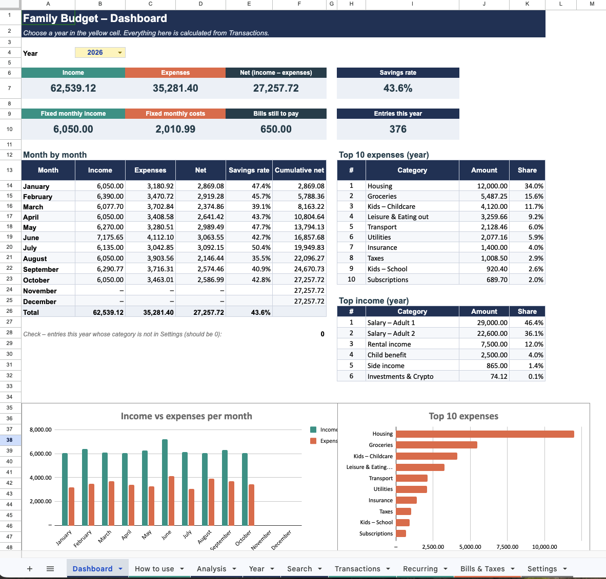
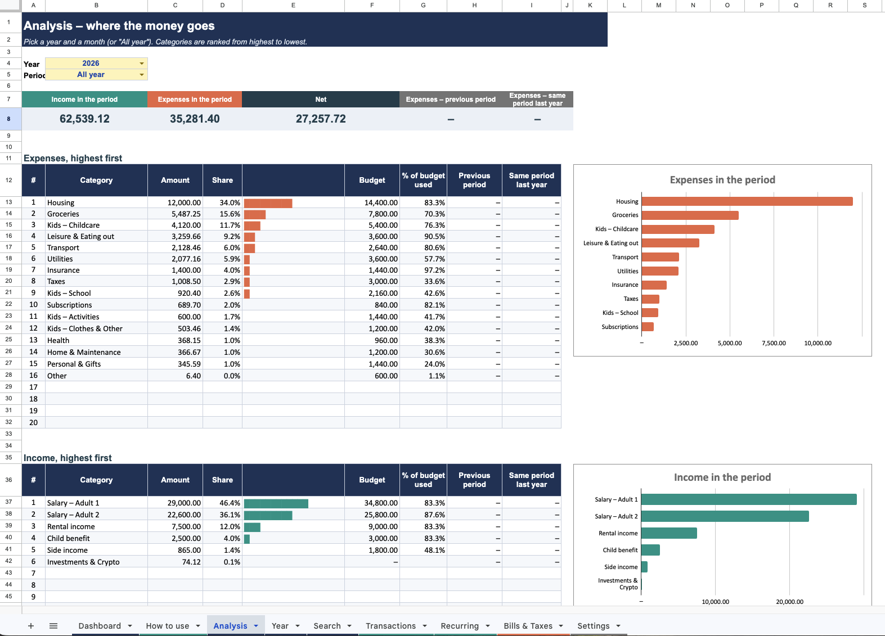
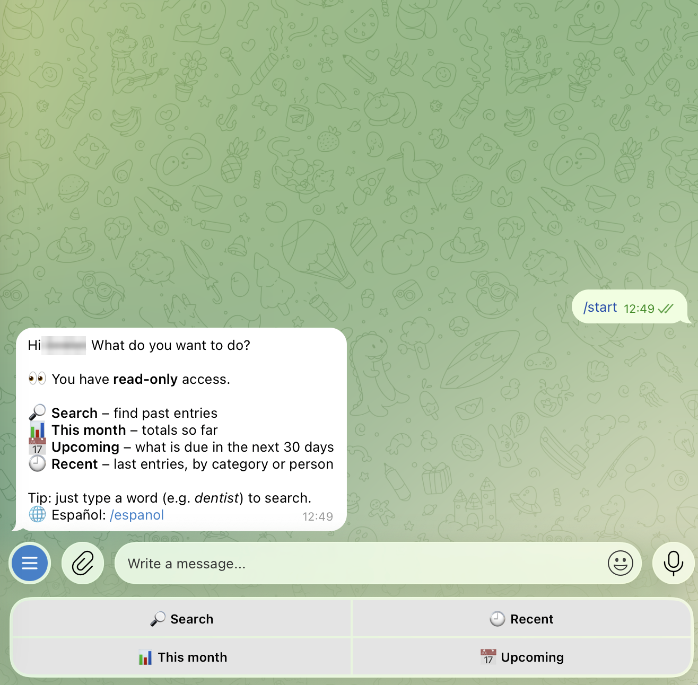

# Family Budget – Google Sheet + Telegram bot

A free household budget that lives in **your own Google Sheet**, with an optional **Telegram bot** to log expenses from your phone in a few taps. No server, no subscription, no AI reading your data – just a spreadsheet and a menu of buttons.

*¿En español? Lee [README.es.md](README.es.md).*

## Screenshots

*All screenshots use the demo files with invented data.*

**Dashboard** – the year at a glance

**Analysis** – every category ranked, against its budget

**Telegram** – the menu of a read-only user

## What you get

**The spreadsheet** (English or Spanish)

- **Dashboard** – pick a year: income, expenses, savings rate, month-by-month table, top 10 expenses and charts.
- **Analysis** – pick a year and a month (or the whole year): every category ranked from highest to lowest, with its share, budget used, previous period and same period last year.
- **Year** – every category month by month against its budget, plus spending by person and by who paid.
- **Search** – filter by word, type, category, year, month or person.
- **Recurring** – rent, salaries, fees… added automatically on their date.
- **Bills & Taxes** – one-off or yearly payments with reminders before the due date.
- **Settings** – your own categories, people, payers and payment methods. Add a child, an adult or a new category by typing it in an empty row.

**The Telegram bot** (optional)

- Buttons, not commands: ➖ Expense, 🧾 Tax, ➕ Income, 🔎 Search, 📊 This month, 📅 Upcoming, 🕘 Recent, ↩️ Undo.
- While adding an expense it shows the last entries of that category, so nobody logs the same thing twice.
- 🕘 Recent shows who each entry was for and who logged it, filterable by category or person.
- Several currencies: type `42000 ars` or `100 usd` and it converts with that month's rate.
- Reminders for bills, automatic posting of recurring items.
- Optional 📤 Export: a month or a year as a CSV file in the chat. Off by default; the sheet owner turns it on, and only full-access users get it.
- **Closed by default:** it answers only the Telegram IDs listed in the sheet. Full-access and read-only users. New people join with a secret word and one tap from you.
- English and Spanish, chosen per person (`/english`, `/espanol`).
- The script can only open the one spreadsheet it is installed in.

## Why buttons and not AI

Many new bots send every message to an AI model to understand it. That is useful for free text and receipt photos, but most everyday jobs don't need it. When the choices are known – a category, a person, a date, an amount – a few buttons are faster, never misunderstand you and always give the same answer.

Leaving AI out also keeps this the **easiest and cheapest path**:

- **No cost, ever.** No API keys, no paid plans, no usage bills. It runs on a free Google account and a free Telegram bot.
- **No server.** Google Apps Script runs the bot inside the spreadsheet. Nothing to install, update or keep online.
- **Your data goes nowhere else.** It stays in your Google Sheet and your Telegram chats; no third-party service reads it.
- **Predictable.** The same tap always does the same thing, so anyone in the family – or the team – can use it without training.
- **The sheet is the admin panel.** To change what the bot knows, you edit a cell. No code, no redeploy.

**An example beyond the family.** A small business keeps its price list and stock in a Google Sheet. The owner updates a price in the sheet at 9:00; at 9:05 a salesperson on the road taps *🔎 Search* in Telegram, types the product name and gets the current price – no outdated PDF, no group chat full of corrections, no app to build. Read-only access means sellers can look but not change anything, and the bot can send them a message when something they need is due. This needs a small change to the bot – pointing Search at a price tab instead of Transactions – see *Use it as a base for your own bot* below. The same pattern fits opening hours for staff, a stock list for a warehouse, a shift rota or the menu of the day.

## What is in this repository

| Path | What it is |
| --- | --- |
| `templates/Family_Budget.xlsx` | Empty spreadsheet, English |
| `templates/Presupuesto_Familiar.xlsx` | Empty spreadsheet, Spanish |
| `demo/Family_Budget_DEMO.xlsx` | Same spreadsheet with ten months of fake data, English |
| `demo/Presupuesto_Familiar_DEMO.xlsx` | Same, Spanish |
| `bot/FamilyBudgetBot.gs` | The Telegram bot (Google Apps Script). One file for both languages |
| `SETUP.md` / `SETUP.es.md` | Step-by-step setup guide for non-technical people |
| `tools/` | Python script that generates the four spreadsheets (only needed if you want to change the templates) |
| `docs/` | Screenshots used in this README |
| `CHANGELOG.md` | What changed in each version |

## Quick start

1. Download a template from `templates/` (or the latest [Release](../../releases)).
2. Upload it to Google Drive and use **File ▸ Save as Google Sheets**.
3. Want the bot? Follow **[SETUP.md](SETUP.md)** – about 30 minutes, once, on a computer.

<!-- Optional: if you publish "Make a copy" links, put them here:
- English: [Make a copy](MAKE-A-COPY-LINK-EN)
- Spanish: [Hacer una copia](MAKE-A-COPY-LINK-ES)
-->

## Not only for families

The same sheet and bot work for anything where a few people share money and want a clear record:

- a shared flat or a holiday house split between friends,
- a sports club, a parents' association or a choir treasurer,
- a freelancer or a small side business tracking income, costs and tax payments,
- a project budget with recurring costs and deadlines,
- looking after the finances of an elderly relative, with read-only access for siblings.

Rename the categories and people in Settings and it fits.

## Use it as a base for your own bot

Under the budget there is a general idea that works for much more than money: **a Google Sheet as the database, a Telegram bot with buttons as the phone app, and Apps Script as the free server in between.** Nothing to host, nothing to pay, and the data stays in a spreadsheet anyone can open, sort and fix by hand.

The bot is one file (`bot/FamilyBudgetBot.gs`), and the parts you would change are kept separate:

- **The buttons** – `mainKeyboard_()` decides which buttons each person sees.
- **The texts** – `TXT` (bot messages) and `UI` (spreadsheet menu) hold every sentence in English and Spanish, so you can reword or translate without touching the logic.
- **The sheet vocabulary** – `WB_ES` maps tab and column names; the bot finds everything by name, not by position.
- **The flows** – `handleUpdateInner_()` and `onCallback_()` route each tap to a step: pick from a list, choose a date on a calendar, type an amount, confirm and save a row.

The plumbing you would otherwise have to write yourself is already done and tested: the closed access list with full and read-only users, the secret-word invitations, a daily automation trigger, reminders, undo, search, duplicate warnings, per-person language and protection against formulas typed into cells.

Ideas people could build from it:

- a **price list for sellers** – they search a product and always get today's price,
- a shared **shopping list** or **pantry inventory**,
- **chores and pocket money** for the kids,
- a **car, bike or home maintenance log** with reminders (inspection, insurance, boiler service),
- **club membership fees** – who has paid this month,
- **stock and sales** for a small shop or a market stall,
- a **habit, health or medication log** shared with a carer,
- **hours worked** per client for a freelancer.

If you build something from this, open an issue or a pull request to share it – a link to your version is welcome.

## Need AI for one step? Plug it in

No AI is required, but nothing stops you from adding it where it really helps – reading a receipt photo, sorting a free-text note, summarising the month. Apps Script can call any AI service that has a web API (Google Gemini, OpenAI and many others). A typical flow:

1. Someone sends a photo of a receipt to the bot.
2. The script downloads it from Telegram and sends it to the AI service, together with your own category list from Settings.
3. The AI answers with the date, total, shop and the best category.
4. The bot shows it as a normal entry with buttons – *✅ Save* or *✏️ Change* – so a person always confirms before anything is written.

**Your API key stays private.** You store it in the script's hidden settings (Apps Script ▸ Project Settings ▸ Script properties), the same place the Telegram token lives. It is never in the spreadsheet cells, never in the code you publish and never on anyone's phone. The call to the AI goes out from Google's servers, so Google Apps Script works as your private go-between: Telegram users talk to the bot, the bot talks to the AI, and nobody in the chat ever sees the key.

Keep in mind:

- **Your data does go to the AI provider** for that step. How private it stays depends on the provider and your plan – some free tiers may use what you send to improve their models. Read their terms before sending receipts with card numbers or addresses.
- **People who can edit the spreadsheet can open its Apps Script and see the script properties.** Only give edit access to people you trust; everyone else can use the bot or view the sheet.
- **Never commit a key to GitHub.** If one leaks, delete it in the provider's console and create a new one.
- **Costs are yours.** Each call is usually cheap and some providers have free tiers, but set a spending limit in the provider's console.

## How it compares

Bots that log expenses from Telegram into a Google Sheet already exist – see the similar projects below, worth a look. Most are built for one person and work with typed commands, and several newer ones rely on an AI service. This project puts together:

- **built for a family or a small team:** full-access and read-only people, invitations with a secret word and one tap, and "For" and "Paid by" on every entry;
- **buttons only, no AI**, free and with no server;
- **several currencies** with monthly exchange rates;
- **recurring items posted automatically** and **reminders** for bills;
- **help against double entries:** 🕘 Recent, the last entries of a category shown while adding, and a warning before saving a possible duplicate;
- **ready-made spreadsheets in English and Spanish** with Dashboard, Analysis, Year and Search, plus demo files;
- **a setup guide for people who don't code.**

**A confession.** I searched for similar projects *after* building this one, so I've updated my personal rules for side projects:

1. Before building anything, search for projects that already do something similar.
2. Don't forget rule number 1.
3. Now build it anyway – yours will be different, and you'll learn a lot along the way.

Here's what I found when I finally got to rule 1:

**Similar projects**

- [PersonalExpenseReport](https://github.com/R3D4NG3L/PersonalExpenseReport) – Apps Script + Google Sheets expense report with a Telegram bot and a dashboard.
- [finance-tracker](https://github.com/Yatharth-Vaish/finance-tracker) – log income and expenses from Telegram into a Sheet with a cash-flow dashboard, no server.
- [Expensly](https://github.com/valbert29/Expensly) – Apps Script home-budget bot with reminders.
- [Expenses-Tracker-Telegram-Bot](https://github.com/kaiimran/Expenses-Tracker-Telegram-Bot) – minimal Apps Script bot that writes expenses to a Sheet.
- [telegram-expense-tracker](https://github.com/kost-t-human/telegram-expense-tracker) – a Telegram Mini App that saves to your own Sheet.

## Privacy

Your data stays in your Google Drive. The bot ignores everyone who is not in your list, works only in private chats, and the script is limited to its own spreadsheet. Keep the BotFather token and the secret word private. Details in [SETUP.md](SETUP.md#privacy-and-safety-in-plain-words).

## Contributing

Issues and pull requests are welcome. Please never attach a spreadsheet with real data – use the files in `demo/` to show a problem.

## Author

Made by Emilio Cano – [https://github.com/em-xdev](https://github.com/em-xdev)

## License

[MIT](LICENSE)
